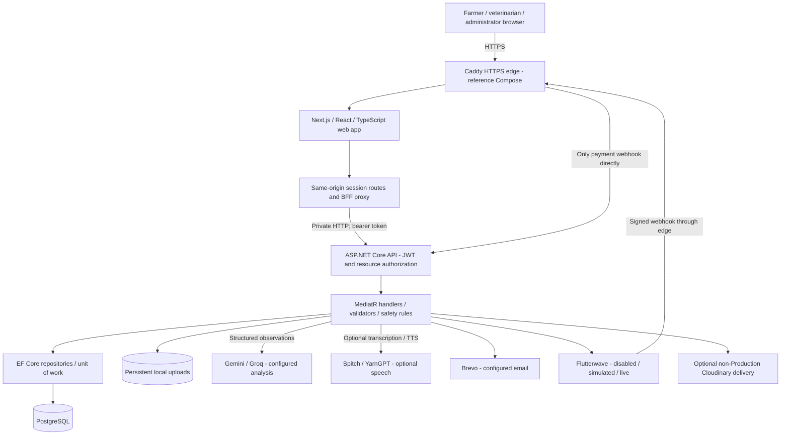

# FarmHand architecture

This describes the repository's implementation and supplied reference deployment. Runtime evidence belongs in [TEST_REPORT.md](TEST_REPORT.md); the public Vercel frontend's backend topology has not been established from Compose.

## System overview

In local development the browser uses `http://localhost:3000` and the private API normally listens at `http://127.0.0.1:5037`. The browser's API calls go to the web origin, not directly to that API address. `FARMHAND_API_URL` is a server environment variable.

## Code boundaries and persistence

| Layer | Responsibility | Source |
|---|---|---|
| Web | Role navigation, forms, drafts, runtime response schemas and query cache | `web/src/app`, `web/src/components`, `web/src/lib` |
| API | HTTP/authentication/authorization/rate limiting/error mapping | `src/FarmHand.API` |
| Application | Commands, queries, validation, projection and care workflow | `src/FarmHand.Application` |
| Domain | Entities, lifecycle rules, money and repository contracts | `src/FarmHand.Domain` |
| Infrastructure | PostgreSQL repositories, providers, encryption, storage and migrations | `src/FarmHand.Infrastructure` |

The core relationship is User → owned Farm → animal/group and Observation → AIDiagnosis/assessment and optional Incident → VetRequest → Payment and TreatmentPlan → dated treatment steps. Incidents also have actions and follow-ups. Soft-deleted entities are filtered by EF model configuration. Audit records accompany important actions. The legacy database entity name `AIDiagnosis` does not mean the product has made a confirmed veterinary diagnosis.

## Authentication and privacy

The API validates JWT issuer, audience, signature, expiration, active user and token version. Resource authorization adds farm ownership or case assignment checks. Farmers cannot self-register as vets or administrators. Refresh tokens are hashed, rotated and reuse checked; account deactivation/password changes/global revocation invalidate sessions.

Next.js stores tokens in HttpOnly cookies, attaches the bearer token server-side, and checks state-changing requests using the FarmHand CSRF header and origin/host relationship. Production cookies are Secure. Identity changes and expiration clear browser query state and attempt device-draft cleanup; owner filtering protects the draft UI if storage cleanup fails. Browser routing is a convenience; the API is the authority.

Drafts additionally carry an owner user ID: read/list/restore paths filter ownership even when browser cleanup fails. Private BFF responses, including media, remain no-store. Successful web logout clears current-device cookies; global logout is only confirmed after API revocation succeeds. If the browser cannot reach web logout, it reports failure and retains the active session instead of claiming logout. Final browser verification of these states is recorded in the test report.

Private local media must be resolved through the API and checked against the owning animal/report/case. Production validation requires explicit `Storage:Provider=Local` and a configured `Storage:LocalPath`; `Auto` and `Cloudinary` are rejected. The deployment operator must verify persistent mounts and filesystem permissions: configuration validation cannot prove those properties. Optional non-Production Cloudinary uploads return public delivery URLs; signed upload does not make them private. Private cloud delivery and a retention/deletion policy remain proposed work.

## Analysis and language processing

1. Authorize the farm and selected subject, validate fields/file signatures and size, and check the idempotency key.
2. If configured, transcribe audio or analyze an image. Text extraction tries configured Gemini/Groq providers. Model-supplied consumption fields use approved categories; symptom and image concerns are mapped to approved labels. Photo descriptions/uncertainty wording and clarification prompts are supplied by the server rather than copied from arbitrary provider prose.
3. Store a pending report with input channels, extracted fields, language hint and explicit source. Farmer-submitted wording is retained within validation/sanitization/length limits; the model cannot silently rewrite or translate the farmer's notes. The farmer reviews/corrects the fields, with explicit entered values taking precedence, including zero deaths.
4. Confirmation combines the report, subject and farm history with urgency analysis. Source-labelled deterministic rules provide a safety baseline and fallback. Approved care wording must remain qualified and avoid medication prescriptions or disease claims.
5. Persist the confirmed assessment and any required incident consistently; duplicate confirmation returns existing state. Optional speech is best effort and must not invalidate saved clinical records.

Read-time mapping also constrains historical extraction symptoms/questions and stored vision output. `AIDiagnosis` detail projection derives approved guidance from the observation, stored urgency/source and recorded flock size, rather than replaying the saved model summary/action prose. This does not write back to the historical record. Farmer wording and professional treatment plans retain their separate provenance; a safe display projection is not clinical validation or a rewrite of user-authored history.

Production rejects `Ai:DemoFallback=true`, which controls demo text extraction. **Confirmation can still use labelled deterministic urgency rules** when an assessment provider is absent or fails. This is intentional graceful degradation, not evidence of a successful AI call.

The code recognizes English, Yoruba, Hausa, Igbo and Nigerian Pidgin report-language hints and provides optional speech integrations. Current approved assessment wording and its optional TTS use English; other report languages receive an explicit English safety-fallback notice while input-language metadata is retained. Clinical accuracy, translation quality and real provider success are unverified.

## Veterinary and payment workflow

Farm owner creates an open/targeted request on an eligible case → vet atomically accepts an eligible pending request → assigned vet gains relevant case/contact access → farmer obtains an authoritative fee quote → server initiates/verifies payment → assigned vet shares a plan and dated steps → farmer records follow-up and step completion. Consultation completion with a fee requires verified payment.

New request fees currently use `PaymentPolicy.FixedConsultationFee` (NGN 20,000) plus 5% platform commission. The stored request and server quote determine actual charges. The fee is a product assumption requiring user research.

Payment initiation uses idempotency and pending-payment constraints. Merchant reference and provider transaction ID are separate. Redirects never prove payment; server verification checks provider status, amount and currency. The webhook validates its signature and verifies the transaction independently. Simulated payments are explicitly labelled and prohibited in Production configuration.

## Reference deployment and release

`compose.yaml` provides PostgreSQL, a one-off migration service, API, web and Caddy. API/database have no public host ports. Caddy routes web traffic to Next.js and only the signed payment webhook directly to the API. Database/upload volumes persist; API/web run with restricted privileges. Caddy manages TLS in the target environment. Development Compose binds loopback ports and enables clearly labelled demo data and simulated payments.

`/health` is API process liveness. `/health/ready` checks database connectivity and pending migrations; web `/api/health` forwards readiness. Neither establishes that email, AI, speech, storage delivery or payment settlement works. Integration status is configuration status, not an external service probe.

See [DEPLOYMENT.md](../../DEPLOYMENT.md) for configuration, migration preflight, backup/restore, bootstrap and rollback. A filtered unique active-request index must not be applied blindly to existing duplicates; inspect and resolve them with the owner before migration. No automatic data deletion is part of the release.

## Scale and operational limits

| Concern | Present design | Next step when justified |
|---|---|---|
| Database queries | Paged modern searches, batched projections and release query/index hardening | Measure realistic data; use `EXPLAIN`; bound remaining unpaged directories/history; consider cursor pagination |
| Connection management | Scoped EF contexts and Npgsql provider pooling | Set explicit capacity budgets and monitor active connections before adding replicas |
| Provider latency | Bounded HTTP clients/resilience; analysis remains synchronous | Durable queue/job status, provider concurrency budget and circuit telemetry |
| Notifications | Best-effort provider email in request flow with a five-second total budget; cancellation and failure do not imply delivery | Durable outbox/worker to avoid lost notifications and partial broadcasts |
| Rate limiting | API per-IP/per-user in-process budgets | Distributed enforcement for multiple API replicas; preserve client identity across trusted proxies |
| Web replicas | Refresh coalescing is process-local | Distributed refresh coordination before horizontal web scaling |
| Storage | Production requires explicit Local provider and persistent upload mount; non-Production may use public external delivery | Shared private object storage, access-controlled URLs and lifecycle retention |
| Monitoring | Structured logs/error trace IDs and readiness | Hosted metrics/traces, p95/error/provider alerts and backup-failure alerts |
| Recovery | Persistent volumes and documented backup requirements | Tested encrypted off-host backups, retention, monitored schedules and target-environment restore drill |

The local 10/25/50-user benchmark can characterize the tested host and dataset only. It does not establish production capacity, fault tolerance, clinical safety or provider concurrency. There is no claim of multi-region availability or a production uptime SLO.

Actual completed evidence: [PERFORMANCE_REPORT.md](PERFORMANCE_REPORT.md) records 510 successful authenticated reads with zero unexpected errors/429s; [RECOVERY_REPORT.md](RECOVERY_REPORT.md) records a fresh local restore with 15 matching selected table counts. EF model consistency is clean with 13 migrations applied locally. Compose/Caddy configuration validation passed; Linux Docker execution was not possible because this host lacks Docker Engine. Hosted recovery, uploads/key restoration and real external services remain unverified.

Dashboard release queries aggregate per-farm counts in PostgreSQL, retrieve active requests independently of the newest-50 activity window, and retrieve pending treatment reminders across the farm. Paid-request IDs are checked before recommending payment, so an accepted request already paid does not override due follow-up with a stale payment prompt. Candidate regression results remain in the test report.
